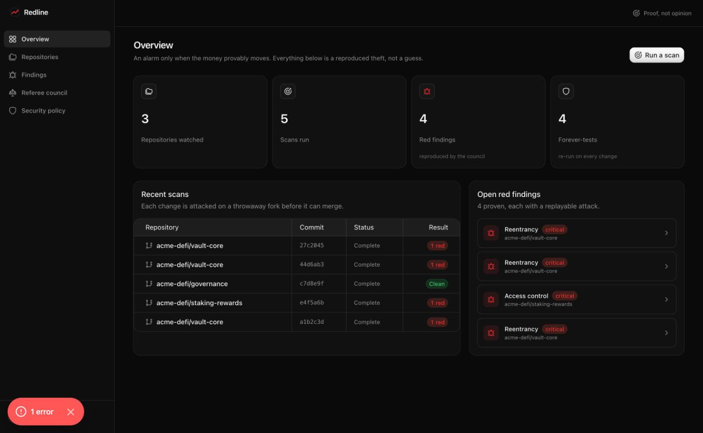
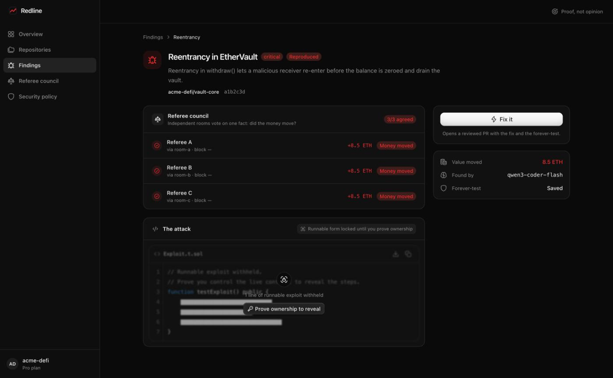

# Redline

[](https://github.com/Quantapar/redline/actions/workflows/ci.yml)

**Continuous security testing for smart contracts. Proof, not opinion.**

Static analysis and AI scanners tell you a bug *might* be reachable. Redline proves
it by reproducing the theft on a throwaway copy of the chain, where nothing real is
at stake. You only get an alarm when independent referees agree the money actually
moved — and the alarm comes with a replay you can run yourself.

## Screenshots

The dashboard — only reproduced thefts are shown, never guesses:



A finding — the referee council's proof, the value moved, and the attack (its runnable form
stays locked until you prove you control the contract):



## How it works

1. **Install** the GitHub App and pick your repos. It finds your contracts and test setup.
2. **First scan** probes the whole codebase once and shows a starting report.
3. **Every change** is probed incrementally — the contracts that changed in the push or PR.
   (Expanding the blast radius to call-graph-connected code is a planned refinement.)
4. **Referee council** re-runs each candidate as plain transactions on independent
   fresh forks. A finding is red only if the referees agree value moved.
5. **Fix it** generates the smallest fix (a diff and an explanation) and saves the attack
   as a permanent regression test that re-runs on every future change, so a fixed bug
   can't quietly return. (Opening the branch as a PR, and re-attacking the fix on a fresh
   fork before merge, activate with the GitHub-write and Foundry integrations.)
6. **Going-live gate** — `redline verify-deploy` exits non-zero on a red or unchecked
   version, so CI or a pre-deploy hook can refuse to ship it.

The referee council is the heart of the product: the search can vary and cut corners,
but the verdict is a consensus of real runs voting on one fact — *did the money move?*

## What we promise

- Every alarm is real and comes with an attack you can run yourself.
- Every fix is checked against the attack that found the bug, forever.
- Your code stays private.

We never promise your code is "safe" or "bug-free," nor that we replace a human audit.
We say "survived these attacks, at this time."

## Features

- **Referee council** — a finding turns red only when a quorum of independent referees, each in
  its own sandbox, agree value moved. The search can cut corners; the verdict cannot.
- **Two-room defense** — hunters may use shortcuts while searching; referees strip them and run
  the attack as plain transactions, so a cheat-dependent "exploit" never raises an alarm.
- **Model swarm** — a model-agnostic router client runs cheap models first and escalates only
  where they stall, under a hard per-scan budget cap.
- **Fix it** — reads the vulnerable contract and generates a reviewed fix (a diff plus a plain
  explanation) with the attack saved as a permanent regression test. Opening the branch as a GitHub
  PR is the next integration step. Or use the **MCP connector** so your own AI tool writes the fix.
- **Going-live gates** — a reproduced finding blocks a deploy through `redline verify-deploy`, which
  exits non-zero on a red or unchecked version (wire it into CI or a pre-deploy hook). An on-chain
  ENS deploy-lock and a Safe multisig guard are the planned extension, not yet wired.
- **Watch mode** — a new hack appears, becomes a recipe, and re-tests every repo.
- **Security policy** — plain-English rules in `.redline/policy.yml`, managed with `redline policy`.
- **Recipe library on Arkiv** — a shared, public library of attack patterns, stored as queryable
  entities on the [Arkiv](https://arkiv.network) testnet. The swarm reads it on every scan, watch
  mode publishes to it, and every reproduced theft publishes its public proof there too (see below).
- **Encryption at rest** — saved attacks are AES-256-GCM encrypted with a customer-held key.
- **Ownership gate** — the finding is public; the runnable attack is redacted until you prove you
  control the contract.

## Monorepo layout

| Package | What it is |
| --- | --- |
| `packages/shared` | Domain model, the council consensus algorithm, budget and ownership guards |
| `packages/db` | PostgreSQL schema and data access |
| `packages/engine` | Fork orchestration (Foundry anvil/forge), static analysis, referee runs |
| `packages/hunters` | Model-agnostic swarm orchestration (OpenAI-compatible router client) |
| `packages/worker` | BullMQ job processors (scan pipeline) |
| `packages/gates` | Going-live deploy lock and Safe guard decisions |
| `packages/arkiv` | The public recipe library and public proofs on Arkiv (schemas, writes, reads) |
| `packages/cli` | `redline policy` and `redline scan` for local use |
| `apps/github-app` | Probot GitHub App: webhooks and checks |
| `apps/web` | Next.js dashboard, live scan room, finding and going-live pages |
| `apps/mcp-server` | MCP connector: your own AI tool pulls a finding and writes the fix |

## Arkiv: the public library and the public proofs

Two of Redline's collections are public by design and live on the Arkiv testnet (**Rabdi**,
chain id 7794095) rather than only in our Postgres:

- `redline.recipes`: the attack-recipe library. The worker reads it at the start of every scan
  (`packages/worker/src/pipeline.ts`, `loadRecipes`) and the `/recipes` page renders from it.
  Watch mode publishes each new recipe (`packages/worker/src/watch-mode.ts`).
- `redline.proofs`: the referee council's proof of every reproduced theft, votes and balance
  receipts only, never the attack (`publishFindingProof` in `packages/worker/src/public-proof.ts`).
  The finding page and `GET /api/findings/:id/proof` link to the entity.

Writer wallet (the only address that has written these schemas so far):
`0x782d335aBbbd265841B5f33cDa528ACA9a4F94ea` on Rabdi.

A query anyone can run against the public RPC, no key needed:

```ts
import { createPublicClient } from '@arkiv-network/sdk'
import { rabdi } from '@arkiv-network/sdk/chains'
import { eq } from '@arkiv-network/sdk/query'
import { http } from 'viem'

const client = createPublicClient({ chain: rabdi({ accessKey: '' }), transport: http() })
const { entities } = await client.select().where(eq('arkiv.schema', 'redline.recipes')).fetch()
```

Set `ARKIV_PRIVATE_KEY` (a funded Rabdi wallet) to write, `ARKIV_READ=1` or `ARKIV_ACCESS_KEY` for a
read-only deployment, and `pnpm arkiv:publish` to (re)publish the local library and every red
finding's proof. Schema, judging notes and integration friction are in [`arkiv/`](arkiv/).

AI-tool disclosure: this project was built with AI coding assistance (Claude) directing the
implementation under the author's review; the referees' verdicts in the product are measured
forge runs, not model opinions.

## Local development

Requires Node 20+, pnpm, Postgres, Redis, and Foundry.

```bash
pnpm install
cp .env.example .env     # fill in keys; blank keys fall back to offline fixtures
pnpm db:push
pnpm dev
```

See `docs/ARCHITECTURE.md` for the full design and `docs/SETUP.md` for toolchain setup.

## Try it from the terminal

```bash
# manage your plain-English security policy
redline policy init
redline policy add "No function that moves money may run without a permission check" --severity critical

# hunt + council over a local Solidity project (needs OG_ROUTER_API_KEY; real proof needs Foundry)
redline scan ./my-contracts

# gate a deploy: exits non-zero if the version is red or was never checked
redline verify-deploy --repo acme-defi/vault-core --version "$GIT_SHA" || exit 1
```

Or run the whole stack (with the real Foundry council in the worker) with `docker compose up`.

See `docs/DEMO.md` for the two-minute demo, `docs/SETUP.md` to run it, `docs/MCP.md` for the
connector, and `docs/GITHUB_APP.md` to register the app.
